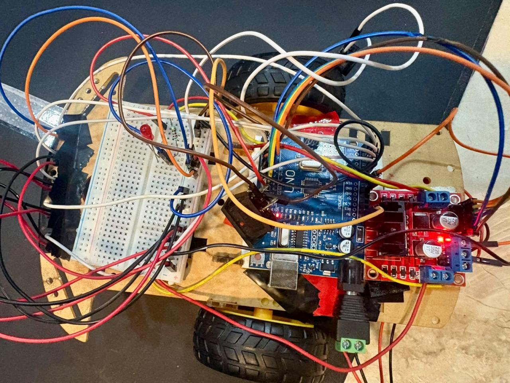
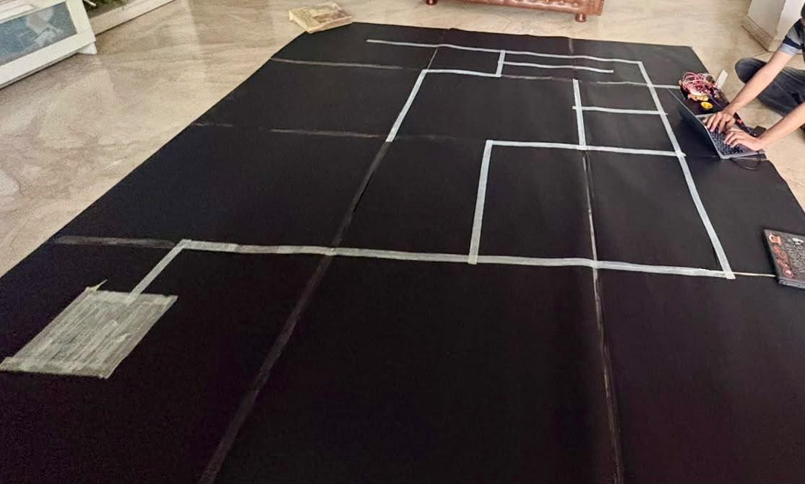
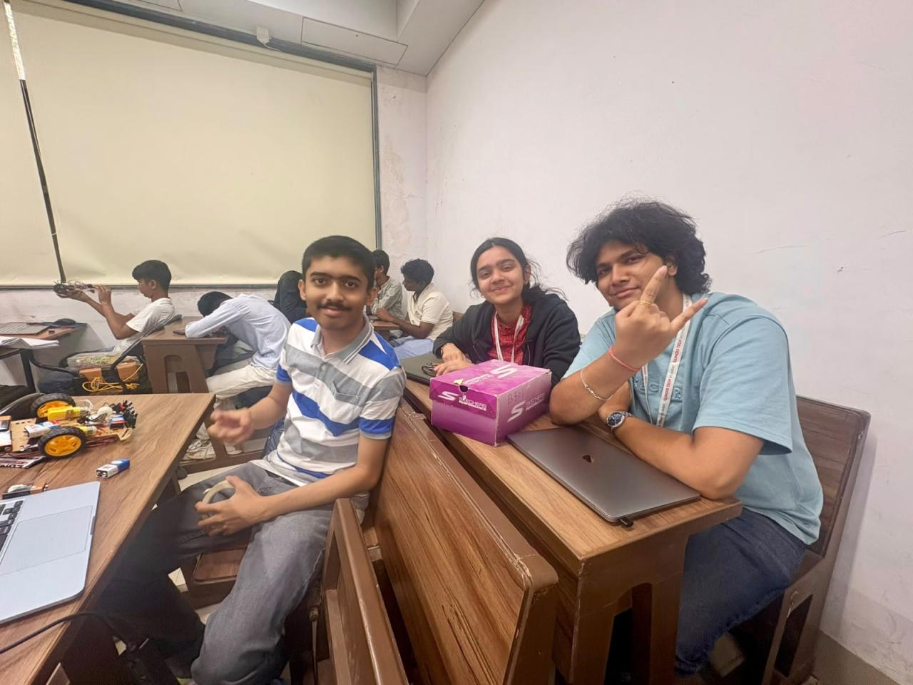

# IIT Bombay Techfest Meshmerize — Line-Following Maze Robot

A two-wheel line-following robot developed for the online **Meshmerize** event at **IIT Bombay Techfest**. The robot uses an Arduino Uno, five IR line sensors, PID steering, and a left-hand-priority strategy to explore and solve a maze.

## Project overview

The main sketch supports a two-pass maze run:

1. **Explore and record:** The robot follows the line, prioritizes left turns at junctions, records its decisions, and simplifies the route when it reaches the end of the course.
2. **Replay the route:** The robot follows the recorded route on a subsequent run during the same power-on session.

During ordinary line tracking, a PID controller adjusts the left and right motor speeds based on the line’s position under the sensor array. At junctions, the robot probes ahead to identify available paths. It stops when all five sensors detect the endpoint and signals completion with an LED.

## Hardware

- Arduino Uno
- Five IR line sensors
- Two DC drive motors and a compatible motor driver
- Start/pause button
- Mode switch
- Completion LED

### Pin assignments

| Function | Arduino pins |
|---|---|
| IR sensors (far left, left, center, right, far right) | A0, A4, A1, A2, A3 |
| Pause button | D2 |
| Explore/replay mode switch | D4 |
| Motor enable (left, right) | D5, D6 |
| Motor direction (left, right) | D7–D8, D9–D10 |
| Completion LED | D11 |

The sensor threshold, line polarity, motor speeds, and PID gains are defined near the top of the main sketch and may need calibration for the specific sensors, surface, and robot chassis.

## Repository contents

- [`line _follower/line_follower.ino`](./line%20_follower/line_follower.ino) — Main maze-solving sketch with PID line tracking, left-priority exploration, route recording, route simplification, and replay. See the [main sketch guide](./line%20_follower/README.md) for its setup and pin details.
- [`Test/Test.ino`](./Test/Test.ino) — Alternative test sketch with proportional line steering, junction handling, and endpoint detection. See the [test sketch guide](./Test/README.md) for its setup and pin details.

## Getting started

1. Assemble the robot and connect the sensors, motor driver, switch, button, and LED according to the pin assignments above.
2. Open the main sketch in the Arduino IDE.
3. Select **Arduino Uno** as the board, choose the correct port, and upload the sketch.
4. Calibrate `THRESHOLD`, `WHITE_IS_HIGH`, the motor speeds, and the PID gains for your track and hardware.
5. Start with the explore/record mode. After the robot reaches the endpoint and signals completion, select replay mode and start another run without powering off the Arduino.

The route is held in memory, so it is cleared when the Arduino restarts. The mode switch is read with the internal pull-up: a HIGH reading selects explore/record mode, and a LOW reading selects replay mode. Replay is available only after a route has been recorded in the current power-on session.

## Team

- Ved Vighe
- Nidhi Shenolikar

## Project photos

### First prototype

### Testing and debugging

### Group photo

## Project repository

This repository contains the project documentation, Arduino sketches, and build photos.
